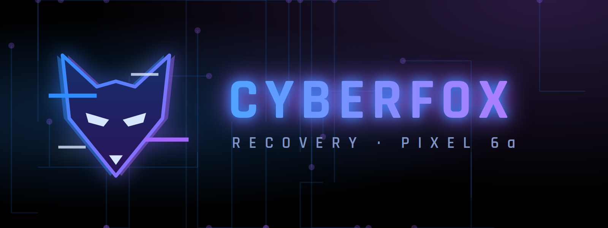
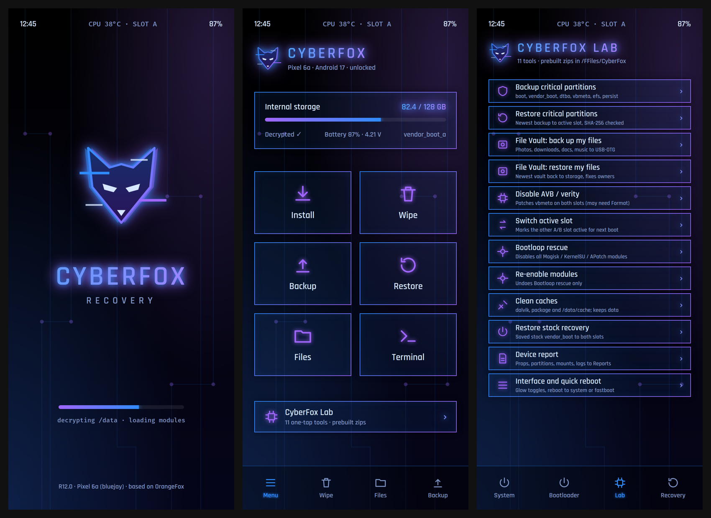

<p align="center"></p>

# CyberFox Recovery for Pixel 6a

CyberFox is a futuristic re-skin and toolkit built on [OrangeFox Recovery](https://gitlab.com/OrangeFox) for the Google Pixel 6a (`bluejay`). It uses the Plasma Circuit design: AMOLED black, electric-blue glowing text, plasma-violet highlights, circuit-trace backdrops, the Rajdhani typeface and the Glitch Fox logo. It also adds **CyberFox Lab**, a menu of one-tap tools that run from pre-built flashable zips baked into the recovery.

CyberFox does not fork the recovery engine. It is a reproducible patch layer applied on top of:

| Layer | Source | Branch |
|---|---|---|
| Recovery | [OrangeFox](https://gitlab.com/OrangeFox/sync) | `fox_16.0` |
| Device tree | [leegarchat/twrp_device_google_pixels](https://github.com/leegarchat/twrp_device_google_pixels) (Pixel 6-11 AIO, includes bluejay) | `R12_16` |
| CyberFox | this repo: theme, Lab page, tool zips, build pipeline | `main` |



> The previews are design renders. On the phone, CyberFox keeps OrangeFox's proven layouts (lists, dialogs, file manager) and swaps the colors, fonts, logo, splash, header glow and icons, then adds the Lab pages. See [docs/DESIGN.md](docs/DESIGN.md).

## What you get

- **Plasma Circuit theme**: a new default style generated from OrangeFox's Black style, electric-blue accent (`#2F8CFF`) everywhere orange used to be, light blue-white text (`#D6E6FF`), blue-tinted icons, a circuit header strip and an electric glow line under every page title. Both effects can be toggled off.
- **New branding**: Glitch Fox logo (SVG, nanosvg-safe), a 1080x2400 splash, a glow halo, and "CyberFox" in every language file.
- **CyberFox Lab** (Settings, then CyberFox Lab). It has 11 tools, each one a flashable zip in `/FFiles/CyberFox`:

| Tool | What it does |
|---|---|
| Backup critical partitions | boot, init_boot, vendor_boot, dtbo, vbmeta* for the active slot, plus efs, efs_backup, modem_userdata and persist, saved to `/sdcard/CyberFox/Backups/<date>` with SHA-256 and a manifest |
| Restore critical partitions | verifies every checksum and the device, then flashes the newest backup to the active slot. efs and persist are restored only if you add an `ALLOW_EFS_RESTORE` file |
| File Vault backup / restore | tars DCIM, Pictures, Download, Documents, Music, Movies and Recordings to USB-OTG (or internal storage), then restores them with the right owner and SELinux labels |
| Disable AVB / verity | checks the `AVB0` header, backs up, then sets the vbmeta flags on both slots |
| Switch active slot | A to B, or B to A, using `bootctl` |
| Bootloop rescue / Re-enable modules | disables every Magisk, KernelSU or APatch module, and the second tool undoes only what CyberFox disabled |
| Clean caches | dalvik-cache, package cache and /data/cache. Apps and data are kept |
| Restore stock recovery | flashes your saved stock `vendor_boot` to both slots |
| Device report | props, partitions, mounts, modules and the log tail, saved to `/sdcard/CyberFox/Reports` |

  Destructive tools ask for a **Vol+ (continue) / Vol- (cancel)** confirmation and cancel themselves after 10 seconds. The same engine is in the terminal as `cfx` (`cfx list`, `cfx backup-critical`, ...).
- **Interface page**: toggles for the header backdrop and the glow, plus quick reboot to system, bootloader, recovery or power off.
- **Everything is tested off-device**: `tools/test_zips.sh` runs all 11 tools against a fake partition table and storage (28 checks).

## Quick start

```bash
# Linux x86_64, ~100 GB free, 16 GB+ RAM, AOSP build deps (docs/BUILDING.md)
git clone <this repo> cyberfox && cd cyberfox
tools/build.sh --top ~/cyberfox_src --sync      # sync OrangeFox 16.0 + device tree, patch, build
# output: dist/CyberFox-R12.0-CyberFox-aio.zip (+ .ramdisk.lz4)
```

Then follow [docs/INSTALL.md](docs/INSTALL.md): unzip, run `install-desktop.sh` in fastboot, wait for `RESULT: OK`, then `fastboot reboot recovery`.

To use only the tool zips on an existing OrangeFox or TWRP install, run `tools/build_zips.sh` and flash any `dist/zips/CFX-*.zip`.

## Repo layout

```
branding/          logo SVGs, generate_assets.py (renders splash, glow, icons, banner)
theme/overlay/     files copied into bootable/recovery/gui/theme (images, fonts, splash.xml, pages/cyberfox.xml)
tools/
  apply_theme.py   patches an OrangeFox theme in place (idempotent, --check for a dry run)
  gen_lab_page.py  builds pages/cyberfox.xml from zips/tools.json
  build_zips.sh    builds the 11 Lab zips into dist/zips
  integrate.sh     copies zips + cfx into the device tree ramdisk
  build.sh         full pipeline: sync, patches, theme, zips, compile, rename
  test_zips.sh     mock-device test suite
zips/              cfx.sh engine, update-binary, tools.json (single source of truth)
previews/          UI mockup renderer
docs/              INSTALL, BUILDING, LAB_TOOLS, DESIGN
```

## Safety

- Recovery lives in `vendor_boot` on the Pixel 6a. Keep your stock `vendor_boot.img`, because rollback is `fastboot flash vendor_boot_a stock_vendor_boot.img` (and the same for `_b`).
- Do not `fastboot boot` the image. Use the installer.
- OTA updates and ROM flashes overwrite `vendor_boot`, so reinstall CyberFox afterwards.
- Back up efs and persist with the Lab tool and copy them to a PC. They are unique to your phone.
- The Google boot logo and the bootloader warning screen are signed and cannot be changed.

## Credits and license

CyberFox is GPL-3.0, like OrangeFox and TWRP. See [NOTICE.md](NOTICE.md) for full credits. Rajdhani is under the SIL Open Font License (see `theme/overlay/common/fonts/Rajdhani-OFL.txt`).
